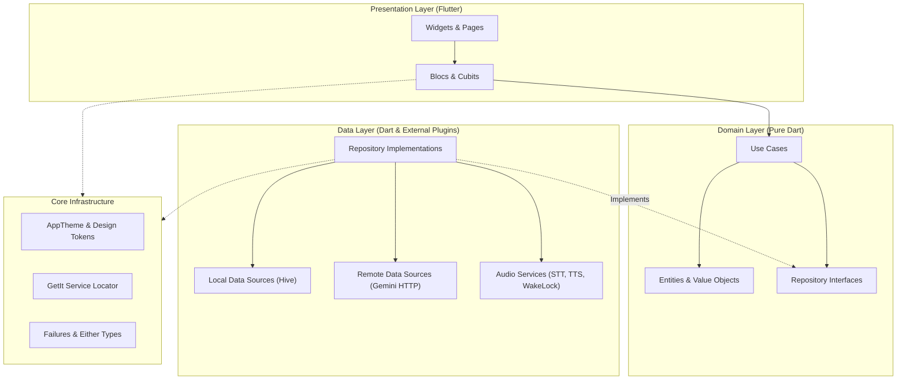
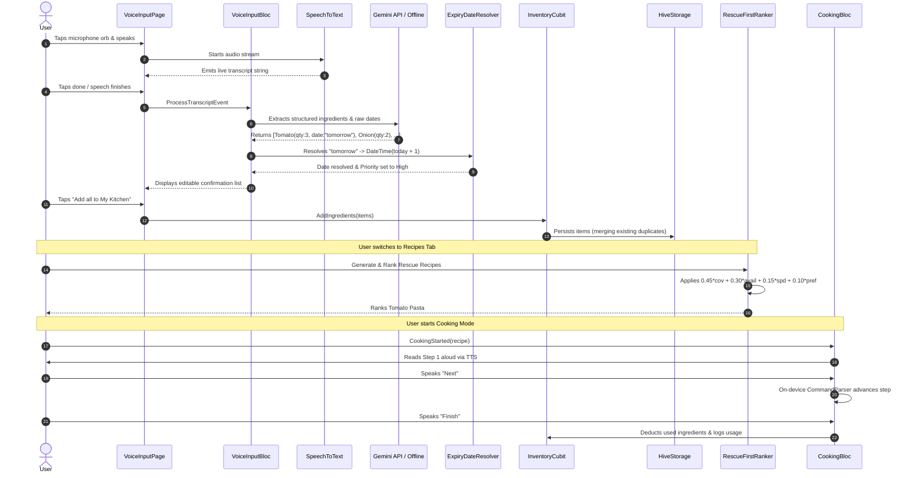
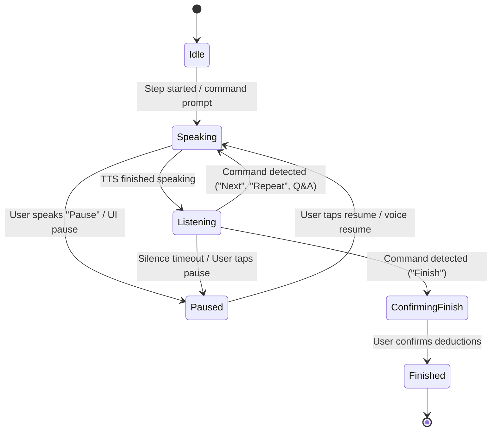

# System Architecture & Technical Specification

## 1. Clean Architecture Layer Hierarchy

RescueRecipe follows strict Clean Architecture boundaries with feature-first modularity. Domain packages are pure Dart, completely isolated from Flutter, Hive, and platform SDKs.



---

## 2. Feature Module Map

The codebase is organized into distinct feature modules under `lib/features/`:

| Module | Core Responsibility | Key Components |
| :--- | :--- | :--- |
| **`voice`** | Audio capture, transcript stream, AI extraction | `VoiceInputBloc`, `GeminiRemoteDataSource`, `OfflineIngredientParser` |
| **`ingredients`** | Inventory management, date resolver, merging | `InventoryCubit`, `ExpiryDateResolver`, `IngredientMerger`, Hive box |
| **`recipes`** | Recipe generation, Rescue-First ranking | `RecipesBloc`, `RescueFirstRanker`, `GeminiRecipeDataSource` |
| **`cooking`** | Hands-free cooking session, voice commands | `CookingBloc`, `VoiceSessionController`, `CommandParser`, `TtsService` |
| **`insights`** | Gamified points, streaks, savings, badges | `InsightsCubit`, `InsightsCalculator`, `WeeklyBarChart` |
| **`notifications`**| Expiry alert scheduling and safety checks | `NotificationService`, `ExpiryAlertPlanner` |
| **`settings`** | Dietary filters, speech speed, data management | `SettingsCubit`, `UserPreferences` |
| **`shell`** | Top-level adaptive scaffold and Home screen | `NavigationCubit`, `HomePage`, `ContentContainer` |

---

## 3. End-to-End Demo Sentence Data Flow

The sequence below illustrates the execution lifecycle when the user speaks:
> *"I have three tomatoes, two onions, spinach and two potatoes. My tomatoes expire tomorrow."*



---

## 4. Cooking Mode Audio State Machine

A critical architectural requirement is that **the app must never listen to its own voice output**. The state machine enforces mutual exclusion between Speech-To-Text (STT) and Text-To-Speech (TTS):



### Audio Mutual Exclusion Rule
- **Speaking State**: `speech_to_text.stop()` is invoked before `flutter_tts.speak()` begins. The microphone hardware is completely powered down.
- **Listening State**: When `flutter_tts.setCompletionHandler` fires, the microphone is re-initialized with an audio session listener.
- **Backgrounding**: When the application enters the background (`AppLifecycleState.paused`), `VoiceSessionController` immediately pauses both TTS and STT and releases audio focus.

---

## 5. Error Handling & Functional Results

RescueRecipe uses `fpdart` to model operations as `Either<Failure, T>`:

```dart
typedef FutureEither<T> = Future<Either<Failure, T>>;
```

### Hierarchy of Failures
- `NetworkFailure`: Connectivity loss or HTTP timeouts.
- `ServerFailure`: Gemini API quota exhaustion or malformed JSON payload.
- `StorageFailure`: Hive disk read/write issues.
- `PermissionFailure`: Microphone or notification permission denial.
- `SpeechFailure`: Platform audio recognition engine failure.

### Release-Safe Fallback
If an unhandled exception reaches the Flutter framework in release mode, `ErrorWidget.builder` intercepts it and renders an error card with navigation options rather than crashing or showing a blank screen.

---

## 6. Design System & Responsive Tokens

The application uses Flutter `ThemeExtension` to provide strongly typed design tokens:

- **Breakpoints**:
  - `Compact`: $< 600\,\text{dp}$ (Bottom navigation bar)
  - `Medium`: $600 - 840\,\text{dp}$ (Navigation rail)
  - `Expanded`: $> 840\,\text{dp}$ (Permanent navigation drawer / 2-column grid)
- **Color Roles**:
  - `Primary Action`: `#E86A33` (Warm Orange)
  - `Surface Light`: `#FFF8EC` (Cream)
  - `Surface Dark`: `#0E1512` (Dark Forest Slate)
  - `Urgent / Critical`: `#D32F2F` (Red)
  - `High Urgency`: `#FF8A3D` (Orange)
  - `Medium Warning`: `#FFC107` (Amber)
  - `Fresh / Success`: `#2E7D32` (Forest Green)
- **Accessibility Guarantee**:
  - All text/surface contrasts exceed WCAG 2.1 AA ($\ge 4.5:1$).
  - All interactive tap targets meet $\ge 48 \times 48\,\text{dp}$.
  - Respects `MediaQuery.disableAnimationsOf(context)` by disabling continuous ambient pulses.
